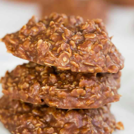

[Back to Main](/README.md)

---

Source: To Die For: A Cookbook of Gravestone Recipes

---
## Ingredients

- 2 cups sugar
- ¼ cup unsweetened cocoa powder
- ½ cup milk
- 8 Tbsp butter
- 1 tsp vanilla extract
- ½ cup peanut butter
- 2 to 3 cups oats

## Instructions

1. Line a baking sheet with wax paper.
2. In a saucepan, mix the sugar and cocoa.
3. Add the milk and butter, bring to a boil, and boil for about 1½ minutes.
4. Add the vanilla and peanut butter.
5. Mix in the oats, starting with 2 cups and adding more until your desired consistency is achieved.  Mix well.
6. Drop large spoonfuls of the dough onto the prepared baking sheet while still warm.  Allow to cool before enjoying.